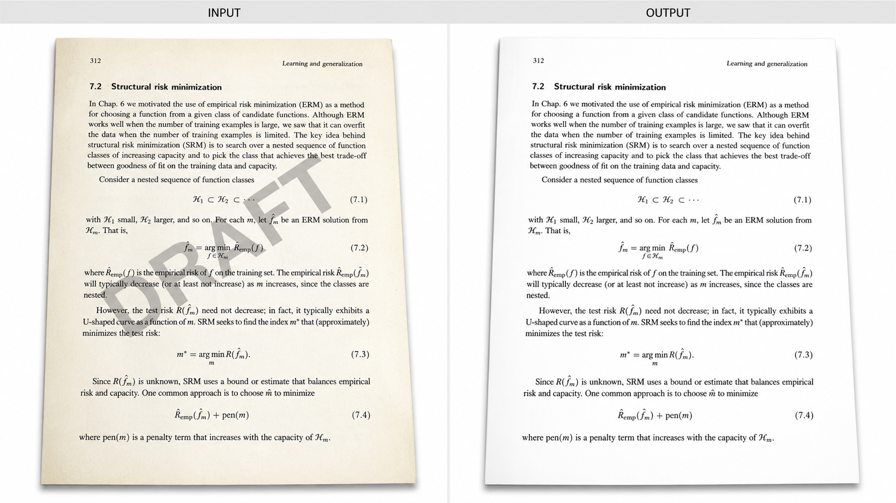

<h1 align="center">Document Watermark Cleaner</h1>

<p align="center">
  <em>A conditional GAN that removes watermarks, binarizes, deblurs, and cleans scanned document images.</em>
</p>

<p align="center">
  
  
  
  
</p>

<!--
TODO: Replace this with a real before/after grid. The single highest-impact
upgrade to this repo is showing a watermarked document on the left and the
cleaned output on the right. Put the image at docs/hero.png.
-->
<p align="center">
  
</p>

---

## Overview

Scanned documents in the wild are messy — overlaid watermarks, faint copies, blur, and noise all hurt downstream OCR and analysis. This project implements **DE-GAN** (Souibgui & Kessentini, 2020), a conditional Generative Adversarial Network that learns to map *degraded* document images to their *clean* counterparts.

The same architecture handles four related tasks (watermark removal, binarization, deblurring, and general cleaning) by changing only the training data. After this README you'll be able to run inference with pretrained weights and train your own variants.

## Highlights

- 🎯 **Four document-enhancement tasks** with a single model architecture
- 🖼️ **Paired-image training** (degraded → ground-truth) keeps the loss interpretable
- 🐍 **Pure Python + TensorFlow 2.x** — no exotic dependencies
- 📜 **Inspired by published research** ([DE-GAN, IEEE TPAMI 2020](https://arxiv.org/abs/2010.08764))

## Capabilities

| Task | Description | Use case |
|------|-------------|----------|
| Watermark removal | Removes overlaid watermarks from documents | Archival recovery, redaction reversal |
| Binarization | Color/grayscale → clean binary | OCR preprocessing |
| Deblurring | Sharpens blurred documents | Phone-captured scans |
| Cleaning | General noise and artifact removal | Quality normalization |

## How it works

DE-GAN follows the conditional-GAN recipe (Pix2Pix–style):

1. **Generator** — a U-Net-style encoder/decoder maps the degraded input to a candidate clean image.
2. **Discriminator** — a PatchGAN classifier tells real clean pairs from generated ones.
3. **Combined loss** — adversarial loss + a strong pixel-wise reconstruction term keeps outputs faithful to ground truth instead of just "plausibly clean."

The training script alternates discriminator and generator updates. Augmentation utilities in `augmentation/` randomly perturb training pairs to improve generalization.

## Project structure

```
.
├── augmentation/        # Data augmentation utilities
├── common/
│   ├── Generator.py     # U-Net generator network
│   └── utils.py         # Helpers (data loading, image ops)
├── service/             # Service wrapper (for inference deployment)
├── predict.py           # Inference entry point
├── train_wm.py          # Train the watermark-removal variant
├── train_dn.py          # Train the denoise variant
├── requirements.txt
└── LICENSE
```

## Getting started

### Prerequisites

- Python 3.7+
- TensorFlow 2.x
- An NVIDIA GPU is strongly recommended for training (8 GB+ VRAM); CPU is fine for inference on small batches.

### Installation

```bash
git clone https://github.com/aifriend/doc_watermark_cleaner.git
cd doc_watermark_cleaner
pip install -r requirements.txt
```

### Download pretrained weights

Pretrained checkpoints are hosted on Google Drive — [TODO: real link] — save them to `./weights/`.

## Usage

### Inference

```bash
# Watermark removal
python predict.py --task unwatermark --input ./data_wm --output ./results

# Binarization
python predict.py --task binarize --input ./input --output ./output

# Deblurring
python predict.py --task deblur --input ./input --output ./output
```

### Training

Prepare paired datasets (degraded + ground-truth images, same filenames in matching folders), then:

```bash
python train_wm.py   # Watermark removal
python train_dn.py   # Denoising
```

Training configuration (epochs, batch size, learning rate) is set at the top of each script — straightforward to tweak.

## Results

<!-- TODO: replace with real numbers and a few qualitative examples. Even 3 example crops
     in a 3×2 grid (input/output) dramatically boosts perceived quality of the repo. -->

| Task | Metric | This implementation |
|------|--------|---------------------|
| Watermark removal | PSNR (test set) | _to be reported_ |
| Binarization | F-measure (DIBCO) | _to be reported_ |

## Roadmap

- [ ] Publish quantitative results on standard benchmarks (DIBCO, custom watermark set)
- [ ] Add ONNX export for lightweight deployment
- [ ] Wrap inference in a FastAPI service (started in `service/`)
- [ ] Replace TF training loop with a PyTorch Lightning implementation for portability

## Citation

If you use this work, please cite the original paper that motivated the architecture:

```bibtex
@article{souibgui2020degan,
  title   = {DE-GAN: A Conditional Generative Adversarial Network for Document Enhancement},
  author  = {Souibgui, Mohamed Ali and Kessentini, Yousri},
  journal = {IEEE Transactions on Pattern Analysis and Machine Intelligence},
  year    = {2020}
}
```

## License

This project is for **academic and research purposes only**. For commercial use, please contact the maintainer. See [LICENSE](LICENSE) for details.

## Author

**Jose Lopez** — AI engineer in Madrid, working on document intelligence and the intersection of biological and artificial intelligence.

- GitHub: [@aifriend](https://github.com/aifriend)
- LinkedIn: [jafdl](https://www.linkedin.com/in/jafdl)

## Acknowledgments

- [DE-GAN paper authors](https://arxiv.org/abs/2010.08764) for the architecture
- The Pix2Pix family of work (Isola et al.) for the broader cGAN-for-image-translation framework
